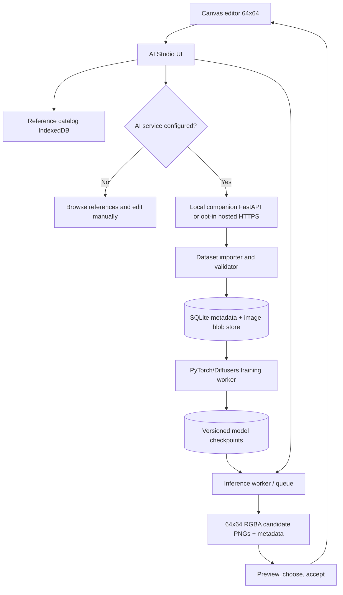

# Canvas AI Studio — architecture and implementation plan

**Status:** approved implementation blueprint, not a deployed generator or trained checkpoint  
**Repository:** `Unborne-Fetus/Canvas`  
**Target:** native 64×64 layered sprite workflow; optional model inference and training backend  
**First design test:** "A fast, aerodynamic Mega Evolution of Scizor with longer pincers and razor-like wings" (Mega Scizor Y)  
**Selected mode:** **Trained model** (real checkpoint required; reference retrieval alone must not be labeled training)

## 1. Goals and non-goals

- Add an **AI Studio** tab to the existing Canvas editor: **Create**, **References**, **Train**, **History**.
- Start with 64×64 transparent PNG output; never introduce blurred or interpolated pixel edges.
- Import a user-expandable sprite reference collection and preserve origin, permissions, metadata, and tags.
- Support real GPU-backed training, named checkpoints, explicit training runs, job logs, cancel, resume, and comparison of versions.
- Support **new creature** generation and **reference-preserving variant editing** (starting from an existing Scizor silhouette). Users can select regions to edit and keep anatomy stable.
- Integrate generated candidates as editable project layers with undo, backup, replace-or-insert, and no accidental overwrite.
- Keep the current browser-only Canvas editor usable without any model or Python service.

**Non-goals for v1:** training a diffusion model in a GitHub Pages tab; instant collaborative cloud editing; guaranteed coherent prompts from a tiny dataset; automatic legal authorization for third-party sprite assets; automatic full semantic-layer separation from a generated single image.

## 2. Current repository integration points

- `index.html` contains the complete dependency-free editor, state, import/export, local autosave, drawing tools, canvas composition, and the GitHub-backed AI Live feature.
- `tests/smoke.mjs` validates the presence of controls/features and parses the embedded JavaScript.
- `.github/workflows/pages.yml` runs smoke tests and deploys **only** `index.html` via GitHub Pages when enabled. Update this workflow to copy the new frontend modules/assets after modularization.
- A Canvas project is `{format:"canvas-fakemon", version:1, width:64, height:64, layers:[{id,name,visible,opacity,pixels}], activeId}`; each `pixels` value is base64-encoded 64×64 RGBA. Do not silently change this schema.
- Existing `?live=sprites/*.canvas.json` sync is **GitHub-to-browser only**. AI Studio runs in-app; it does not require GitHub or ChatGPT for training/inference.

## 3. Proposed architecture



### Recommended deployment

- **Local-first recommended:** run an optional Python companion serving the editor and API together on `http://127.0.0.1:8765`. Same-origin serving avoids the cross-origin/private-network limitations of calling a localhost API from a hosted HTTPS GitHub Pages tab.
- **Hosted option:** connect the static GitHub Pages editor to an authenticated **HTTPS** inference endpoint with explicit user opt-in; account for operating cost, rate limits, and image privacy. Do not put API credentials in public JavaScript or browser storage.
- **No backend:** drawing, reference catalog, exports, palettes, and existing GitHub AI Live continue to work. Generation and true training show "AI service not connected" instead of pretending to run.
- Store model weights, imported source art, job state, and training images in an app data directory, **not in Git or the Pages deployment**.

### Proposed repository tree

```text
index.html
studio/
  ai-studio.js             # UI, input validation, state and editor bridge
  references.js            # browser IndexedDB catalog and thumbnails
  api-client.js            # explicit API connection + job polling
  editor-bridge.js         # preview/apply/undo without flattening existing layers
ai/
  backend/
    app.py                 # FastAPI v1 endpoints, auth/CORS policy
    dataset.py             # import, tags, permissions, splits, thumbnails
    normalize.py           # 64x64 RGBA and nearest-neighbor processing
    train.py               # worker job, checkpoint, resume, progress
    generate.py            # selected trained model inference
    registry.py            # model metadata and version selection
    validation.py          # candidate QA/novelty checks
  contracts/
    reference.schema.json
    generation-request.schema.json
    training-request.schema.json
  tests/
    test_dataset.py
    test_api.py
    test_model_smoke.py
docs/
  AI_STUDIO_ARCHITECTURE.md
tests/
  smoke.mjs
```

Backend modules above are **planned**, not currently implemented. Keep external packages in `ai/backend/requirements*.txt` or pinned environment specifications, isolated from static Canvas.

## 4. Reference library and permissions

### Default expansion asset importer

- The user's existing Pokeemerald Expansion/Brisk Emerald checkout is an **optional import source**, not a guarantee that every sprite can be redistributed or trained on.
- Discover `graphics/pokemon/<species>/anim_front.png` and other supported front sprite paths; inspect dimensions and frame metadata instead of assuming every PNG contains one 64×64 image.
- Extract a deliberate representative frame and exclude blank frames, duplicate pose frames, invalid alpha, and truncated images. Preserve **original image + normalized sample + frame index + source path + source hash**.
- Separate cataloging from training permissions. A file may be visible as a local *reference* without authorization to share or train on it. Do **not** ship a public default set of official Pokémon art or community sprites, or train a distributed model on those assets, until their rights and model-training terms are verified.
- First-run wizard: choose source folder or import ZIP, scan count, review rights/attribution, select allowed subset, confirm. Provide a starter catalogue only from assets with independently documented redistribution/training permission.
- User uploads: PNG, multi-frame PNG (frame selection), ZIP containing PNGs, and Canvas `.canvas.json`; reject unsafe ZIP paths, huge decompressed archives, unsupported encodings, unbounded image dimensions, and executable files. Dedupe SHA-256.
- The collection must be user-expandable: personal uploads remain private by default. Training only uses assets with explicit `permissions.train === true` and images opt-in to a specific dataset version.

### Metadata and tags

Each entry stores `id`, `source`, `sha256`, `width`, `height`, `frame_index`, `tags`, `body_plan`, `pose`, `palette`, `license`, `attribution`, `permissions`, `family_id`, `dataset_split`, and `file_uri`. See `ai/contracts/reference.schema.json`.

Default tagging vocabulary: body plan (`biped`, `quadruped`, `avian`, `serpentine`, `insectoid`, `amorphous`), view (`front`, `three_quarter`, `side`), pose, style family, appendages, and optional combat/type tags. The original pixels never get modified by cataloging.

### Storage

- Browser: IndexedDB for local catalog metadata, thumbnails, and small user uploads. Provide export/import/delete and storage usage.
- Backend: private content-addressed blob store + SQLite catalog. Local browser copies synchronize **only after explicit selection** for a training/generation request.
- Every dataset training job uses an **immutable snapshot** with manifest hash and permission check; deleting/revoking an image excludes it from future datasets, while existing derived checkpoints need separate retention/deletion handling.

## 5. Actual trained-model pipeline (64×64)

### Technical choice

Start with a **small, native 64×64 diffusion baseline** using PyTorch, Diffusers' `UNet2DModel` and a DDPM scheduler, with a custom 4-channel RGBA training/sampling wrapper. Its purpose is to prove dataset ingestion, real weight updates, checkpoint recovery, and sprite generation. This baseline is **unconditional** and will not faithfully follow "aerodynamic Mega Scizor Y" text.

Next implement a **conditional sprite model**: tagged conditioning for `body_plan`, `type`, `pose`, `style` and an image-guided edit path using a base sprite + mask. Use a conditional U-Net architecture and a versioned prompt/tag tokenizer. Free-text prompts require a real language encoder or accurate text-to-tag translator and a matching conditional training dataset; do not claim otherwise. Benchmark conditional model performance before adding it to the main Generate button.

A generic pre-trained text-to-image model fine-tuned and downscaled can be investigated as a comparison, but is **not** native 64×64 pixel art and must be evaluated for blur and design copying.

### Reproducible training workflow

1. Choose an eligible dataset snapshot. Enforce provenance, licenses, splits and hash-deduplication.
2. Decode to RGBA; preserve premultiplied-alpha correctness; normalize to 64×64 with nearest-neighbor only and transparent padding. Do not enlarge small art silently.
3. Pack 4 channels (RGB plus alpha/mask), define exact color-space transforms, threshold alpha at export only, and maintain transparency-loss reporting.
4. Split by **Pokémon/evolution family or origin artist**, not random frames from one species into both training and evaluation. Prevent sprite variants from leaking across splits.
5. Train the model using real optimizer steps and a specified seed on a CUDA-capable GPU where available. Save checkpoint metadata: dataset manifest hash, architecture, source code commit, seed, epochs/steps, optimizer, learning rate, model license, and timestamp.
6. Periodically save checkpoint + optimizer state, progress, losses and fixed-seed sample grids. Support cancellation and resume from a compatible checkpoint.
7. Evaluate held-out samples and user blind ratings: recognizable anatomy, coherent number of appendages, palette count, empty margin, transparency, crisp pixel clusters, similarity to nearest training example (copy risk).
8. Register only checkpoints passing validation; expose "experimental" state for weak models. Keep older checkpoints for rollback.

Training on a few user-uploaded sprites is **not sufficient** to produce a strong model from scratch. Support optional incremental fine-tuning **only from a compatible, appropriately licensed trained checkpoint**. Mark the distinction between *indexed*, *queued for training*, *training*, and *trained*. Never silently retrain after an upload.

### Training operating requirements

- Expose GPU type and VRAM, CPU fallback warning, estimated memory profile from benchmark, and progress/logging. No ungrounded speed or cost promises.
- Training runs are local jobs or authenticated server-side jobs, not tasks running in a GitHub Actions deploy or browser on a static page.
- Freeze environment and seeds; record metrics and data lineage. Never bundle training data or large checkpoint files into `main` or GitHub Pages.
- Provide `train smoke` on a small **original synthetic** RGBA dataset so CI can validate code paths without copyrighted sprites or expensive GPU time.

## 6. Generation workflow

In AI Studio's **Create** tab:

1. Enter description (default for this spec: "A fast, aerodynamic Mega Evolution of Scizor with longer pincers and razor-like wings").
2. Choose `Trained model`, version, canvas 64×64, base-reference image (prefer current layered Scizor project), preserved silhouette/region mask, palette, seed, and count (1–4).
3. Validate checkpoint supports the chosen mode. A base unconditional checkpoint cannot accept text/image guidance; clearly disable unsupported controls.
4. Queue generation; show running, completion, errors, cancel, and reproducible parameters.
5. Render candidates with pixelated nearest-neighbor at 1× and 8×; show alpha, palette count, anatomy flags, similarity warning, and chosen seed.
6. Allow **Accept as new layer**, **Replace active layer**, or **New project**. Never overwrite an existing project without explicit confirmation; integrate with Canvas' 40-step undo history and 24-layer limit.
7. Record accept/reject annotations and optional user corrections. Feedback updates a dataset record **only after explicit opt-in**; it does not magically change current model weights.

### Layer fidelity

- Generated PNG is a **single RGBA image** by default. Do not present it as automatically semantically separated wings/body/claws.
- For native `.canvas.json`, insert the generated PNG as a new layer while retaining all existing editable layers, layer order and metadata. Use semantic layers only when the model produces trusted masks or the user splits the image manually.
- For image-guided variant editing, retain base layers and add editable `AI variant` overlay and mask; keep before/after previews.
- Preserve manual drawing state while jobs run; if the canvas revision changed, ask whether to insert on current project, start a new project, or discard.

### Mega Scizor Y proof-of-concept

**Input:** Scizor base art in Canvas, head and body locked, wings and pincers in editable mask.  
**Prompt/tags:** insectoid / biped / red armor / aerodynamic / long pincers / razor-like wings / mega evolution.  
**Expected behavior:** variations preserve the face, pincer eye-marks, wing attachments and overall Scizor silhouette while proposing speed-focused adaptations.  
**Reject if:** extra limbs, detached claws, duplicated wings, unreadable silhouette, heavy antialiasing, or copied reference pixels without enough meaningful transformation.

## 7. API and data contracts

Versioned local / hosted API. Use documented JSON schemas in `ai/contracts/`. No public anonymous training service.

| Endpoint | Purpose |
|---|---|
| `GET /v1/health` | Backend readiness, model list, GPU capability, supported generation modes |
| `POST /v1/references/import` | Multipart reference imports with per-file rights flags; returns import job ID |
| `GET /v1/references` | Search/filter own reference library |
| `POST /v1/datasets` | Create immutable, permission-checked dataset snapshot |
| `POST /v1/trainings` | Create genuine train/fine-tune job from snapshot |
| `GET /v1/jobs/{id}` | Progress, errors, metrics, artifacts, status |
| `POST /v1/jobs/{id}/cancel` | Cancel queued/running training or generation |
| `GET /v1/models` | Compatible checkpoints and their supported conditioning |
| `POST /v1/generations` | Start native 64×64 generation from model and optional base/mask |
| `GET /v1/generations/{id}` | Candidate assets and parameters |
| `POST /v1/feedback` | Explicitly save accepted/rejected candidate and notes |

- API uses strict request validation, generated random job IDs, per-user job isolation, length/cap limits, file type and image dimension checking.
- Local companion binds to `127.0.0.1`, not `0.0.0.0`, with a session token or equivalent request authentication, explicit origin allowlist and safe CORS. Handle browser private-network restrictions by serving the UI from the companion in local AI mode.
- Hosted API uses TLS, authenticated accounts, quotas and explicit consent before uploading private reference art. Never ship a privileged training token or cloud secret in static website code.
- Production jobs cannot request arbitrary file-system paths, shell commands, or user-provided model pickles.

## 8. UI specification

- Add an **AI Studio** button in the top toolbar, with a right-side panel or modal that does not compress the existing 64×64 artboard on small screens.
- **Create:** prompt, source/selection, model version, supported conditioning, palette controls, variations, seed, Generate, progress, candidate picker, Apply.
- **References:** imported count, source filter, licensing badge, search/tags, image upload/ZIP import, compare, remove, editable permission flags; source attribution shown.
- **Train:** snapshot selector, count of eligible images, architecture, training vs fine-tuning, GPU check, start/cancel/resume, checkpoint gallery and reproducible logs.
- **History:** generated candidates, prompts, model version, seed, rating, restore and delete.
- Keep AI UI optional and accessible; preserve all original Canvas tools; support pointer, keyboard, and responsive mobile layouts.

## 9. Delivery milestones and acceptance tests

### M0 — architecture and contracts (this commit)
- [x] Architectural blueprint for current single-file editor and optional service.
- [x] Reference, training, generation request schemas.
- [ ] Product acceptance review (user verifies expected scope and available GPU).

### M1 — reference library
- [ ] Frontend IndexedDB reference library with import/search/delete and provenance.
- [ ] Importer for expansion-style sprite sheet layout (including frame selection).
- [ ] SHA-256 dedupe, nearest-neighbor normalization, quality and rights checks.
- [ ] Test with original/permission-cleared sample sprites; no default redistribution of unvetted assets.
- **Gate:** imports and browser editing work offline; import never updates model weights automatically.

### M2 — true trainable baseline
- [ ] Python companion, /health endpoint, job queue, SQLite/blob storage.
- [ ] 64×64 4-channel DDPM with checkpoint/resume/sample export and GPU detection.
- [ ] UI exposes real training status and model registry; CI synthetic-data smoke.
- **Gate:** two checkpoint versions generate reproducible fixed-seed samples with measurable trained weights; generation unsupported without a checkpoint.

### M3 — conditional creation/editing
- [ ] Train tag-conditioned model and image-guided region-edit path; add prompt encoding.
- [ ] Inference job API, 1–4 variants, candidate history, pixel-art validation.
- [ ] Add candidate as a genuine non-destructive Canvas layer and preserve undo.
- **Gate:** compare Scizor variant results to unconditional baseline and human ratings; controls disabled for unsupported checkpoints.

### M4 — customization and packaging
- [ ] User opt-in data snapshots and checkpoint adaptation, retention/deletion controls.
- [ ] Local companion installer and optional hosted HTTPS endpoint; privacy guardrails.
- [ ] End-to-end tests, mobile fallback, model metadata and export.
- **Gate:** fresh user can add permitted art, train/adapt, generate, edit, and export without ChatGPT/GitHub.

## 10. Open decisions (do not silently guess)

1. **Hardware and training location:** the user's GPU/VRAM, local companion permissions and whether an optional hosted endpoint is desired.
2. **Training rights:** which Pokeemerald Expansion assets have license/creator permission for the intended dataset, redistribution and model training? Import all *locally for review* if allowed, but ship/train only eligible assets.
3. **Model quality:** benchmark native 64×64 diffusion against any licensed pretrained/fine-tuned pixel-art baseline. Do not commit to one model based on concept alone.
4. **Prompt support:** full language-conditioned images require a trained encoder and sufficient captioned data; a simple unconditional baseline will not interpret descriptive Mega forms.
5. **Privacy:** keep users' personal libraries/checkpoints private by default; opt in separately to sharing or remote processing.

## 11. Relevant upstream training references

- Hugging Face Diffusers: https://huggingface.co/docs/diffusers/training/unconditional_training
- Hugging Face diffusion training tutorial: https://huggingface.co/docs/diffusers/tutorials/basic_training
- Diffusers example scripts: https://github.com/huggingface/diffusers/tree/main/examples/unconditional_image_generation

These sources demonstrate real diffusion training and checkpointing, **not** a finished conditional sprite model for Canvas. The proposed RGBA conditioning/editing and UI bridge require custom implementation and evaluation.
